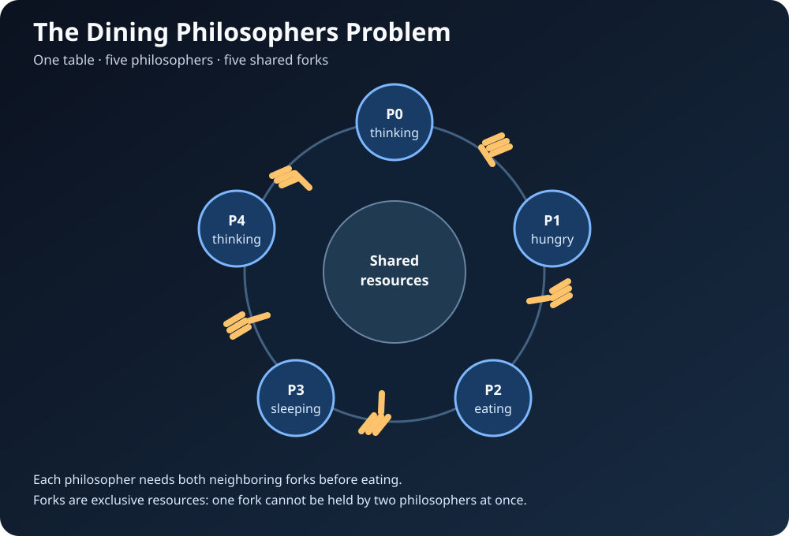
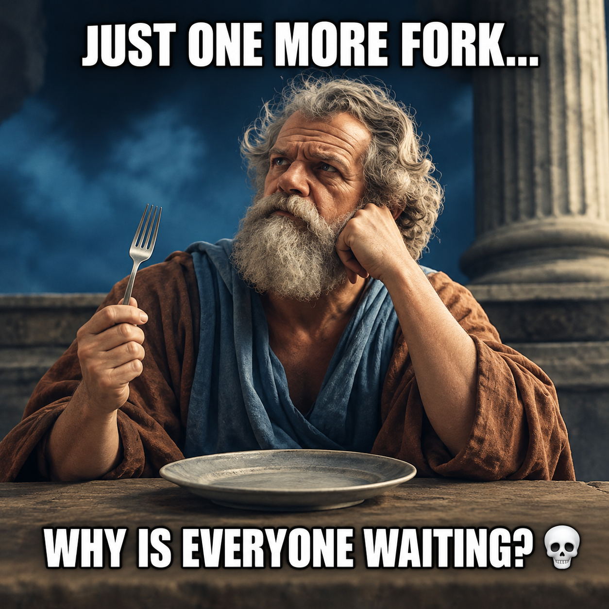
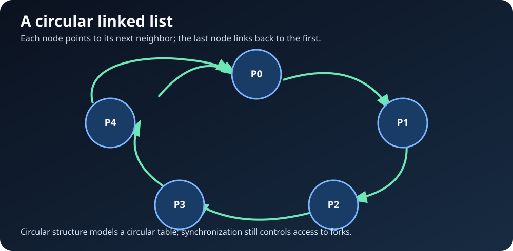

# Philosophers 🍝

## Introduction

I worked on the **Philosophers** project in 2025 at **1337 Coding School**, part of the 42 Network. I really enjoyed this project because it was my first time working with threads, and it made me think differently about how multiple tasks run and share resources.

Before this project, I knew much less about the difference between processes and threads, how they communicate, and why concurrent programs can behave unpredictably. Philosophers helped me explore these concepts hands-on through a classic operating-systems problem.

I am sharing this README to document what I learned and help other students understand the problem, the data structures, and the concurrency challenges behind my solution.

## Project Overview: The Dining Philosophers Problem

Several philosophers sit around a circular table. Between every pair of neighboring philosophers there is one fork, and each philosopher needs **both adjacent forks** to eat. Philosophers alternate between thinking, eating, and sleeping, while the program monitors whether anyone starves.

The challenge is to let philosophers make progress without allowing two philosophers to use the same fork simultaneously, causing a deadlock, or introducing data races when threads access shared state.



**An important detail:** the two-fork requirement is an assumption of the classic problem. In real life, a person can eat using one fork, but in this model each philosopher is defined as needing both adjacent forks before eating. That rule is what makes the resource-sharing problem interesting.



*When you could technically eat with one fork, but the problem's rules say you need both.*

In the usual mandatory version of the 42 project, each philosopher runs in a thread and each fork is protected by a mutex. The exact implementation may vary by project version.

## Philosopher States

The project is often described using three main activities. **Hungry/waiting** is a useful intermediate state when a philosopher is trying to acquire both forks.

| State | Meaning |
|---|---|
| **Thinking** | The philosopher is not using forks and is thinking. |
| **Hungry / Waiting** | The philosopher wants to eat but must acquire both adjacent forks first. |
| **Eating** | The philosopher has acquired both forks and can eat safely. |
| **Sleeping** | After eating and releasing the forks, the philosopher sleeps before thinking again. |
| **Dead** | The simulation detects that the philosopher has exceeded the allowed time without eating. This usually stops the simulation. |

A typical cycle is:

`Thinking → Hungry / Waiting → Eating → Sleeping → Thinking`

The transition to **Dead** can happen when the time since the philosopher's last meal reaches `time_to_die`. The monitoring logic must check this timing carefully.

### Typical program arguments

A common version of the project accepts the following arguments:

```text
./philo number_of_philosophers time_to_die time_to_eat time_to_sleep [number_of_times_each_philosopher_must_eat]
```

- `number_of_philosophers`: number of philosophers and usually number of forks.
- `time_to_die`: maximum time a philosopher can go without eating before the simulation reports death.
- `time_to_eat`: time spent eating while holding two forks.
- `time_to_sleep`: time spent sleeping after eating.
- Optional meal count: stop when every philosopher has eaten enough times, if this option is supported by the version being implemented.

## How I Represented the Table: Circular Linked List

I used a **circular linked list** to represent the philosophers around the table. Each node represents one philosopher and links to the next philosopher. The final node links back to the first node, so the structure matches the circular arrangement of the table.



This made it natural to move from one philosopher to the next and handle the wrap-around case, where the last philosopher is next to the first. It also gave me a clear way to organize each philosopher's information and reason about neighboring philosophers.

**Important:** the circular linked list models the table; it does not by itself prevent deadlocks or data races. Correct synchronization and a safe fork-acquisition strategy are still required. A common deadlock-prevention strategy is to impose a consistent order for acquiring forks, or to use an asymmetric pickup rule so that not every philosopher waits in the same circular pattern.

## Linked List Types

### 1. Singly Linked List

Each node stores data and a pointer to the **next** node. You can traverse forward, but moving backward is not directly supported.

`A → B → C → NULL`

### 2. Doubly Linked List

Each node has pointers to both the **next** and **previous** nodes. It can be traversed in either direction, but each node needs extra pointer storage.

`NULL ← A ⇄ B ⇄ C → NULL`

### 3. Circular Linked List

The last node points back to the first node instead of pointing to `NULL`. It can be singly or doubly linked. It works well for modeling objects arranged in a circle, such as philosophers around a table.

`A → B → C ─┐`  
`↑─────────┘`

## Processes vs. Threads

One of my biggest lessons from this project was understanding how processes and threads differ.

### Processes

A **process** is a running program with its own virtual address space and operating-system resources. Processes are isolated from one another by default, so they cannot normally read and write each other's ordinary variables directly. They can still communicate using **inter-process communication (IPC)** mechanisms such as pipes, shared memory, sockets, or message queues. Pipes are one option, not the only one.

### Threads

A **thread** is an execution path inside a process. Threads in the same process share the process's address space and many resources, which makes sharing data easier, but it also means that shared data must be protected when multiple threads access it concurrently. Each thread still has its own stack and execution state.

Threads are **not themselves processes**. Multiple threads can make progress concurrently, and the operating system may switch between them or run them in parallel on different CPU cores.

| | Process | Thread |
|---|---|---|
| Memory | Separate virtual address space by default | Shares its process's address space with sibling threads |
| Communication | Usually needs IPC to share data | Can access shared variables directly, with synchronization |
| Isolation | Stronger separation | Less isolated from other threads in the same process |
| Main risk in this project | IPC and process coordination in process-based variants | Race conditions and synchronization bugs on shared state |

## Deadlock

A **deadlock** happens when threads are stuck waiting for resources held by one another, so none of them can continue.

In the dining-philosophers problem, imagine every philosopher picks up the fork on their left at the same time. Each philosopher now holds one fork and waits for the right fork. Nobody can eat, and nobody releases the fork they already hold: this is a deadlock.

The classic four conditions that can allow deadlock are:

1. **Mutual exclusion:** a fork can be held by only one philosopher at a time.
2. **Hold and wait:** a philosopher holds one fork while waiting for another.
3. **No preemption:** a fork cannot simply be taken away while a philosopher holds it.
4. **Circular wait:** every philosopher waits for a resource held by the next philosopher in a cycle.

A solution prevents the deadlock by breaking at least one of these conditions. Examples include acquiring forks in a consistent global order, using an asymmetric fork-acquisition rule, or introducing a waiter/semaphore that controls access. The circular linked list helps represent neighbors, while the synchronization strategy determines whether the resource acquisition is safe.

## Data Races and Mutexes

A **data race** occurs when multiple threads access the same memory location concurrently, at least one access is a write, and the accesses are not properly synchronized. This can produce unpredictable behavior and, in C, undefined behavior.

Examples of shared state that may need protection include:

- The time of a philosopher's last meal.
- A flag indicating that a philosopher has died or that the simulation should stop.
- Meal counters or other values read by a monitoring thread while another thread updates them.
- Fork ownership or other shared resources.

A **mutex** is a lock used to protect a shared resource or critical section. A thread locks the mutex before accessing protected data and unlocks it when finished. Other threads must wait until the lock becomes available. Every shared read and write must follow the chosen synchronization policy; locking only the write while leaving concurrent reads unprotected may still be a bug.

```c
pthread_mutex_lock(&data_mutex);
last_meal_time = get_current_time();
pthread_mutex_unlock(&data_mutex);
```

This is a simplified example. In a real program, both writers and readers of `last_meal_time` must use the same synchronization scheme, and error handling must be considered.

### Deadlock vs. Data Race vs. Starvation

- **Deadlock:** threads wait forever for resources and no progress is made.
- **Data race:** conflicting unsynchronized memory accesses produce unpredictable results.
- **Starvation:** a philosopher waits indefinitely or repeatedly loses access to forks while other philosophers continue eating.

These are different problems and need different checks. Preventing a deadlock does not automatically prevent data races or starvation.

## What I Learned

This was one of my favorite projects because I got to work with threads for the first time and see how challenging concurrency can be. I learned to reason about shared resources, synchronization, mutexes, timing, deadlocks, and data races.

I also learned how choosing the right data structure can make a problem easier to model. The circular linked list represented the round table naturally, while the concurrency logic required a separate strategy to keep resource access safe.

Most importantly, I learned that a program can look correct when running once and still contain bugs that appear only under a different thread schedule. Testing different philosopher counts and timings, checking edge cases, and carefully protecting shared data are essential parts of solving this project.

## Conclusion

The Philosophers project taught me how threads cooperate and compete for shared resources. It connected data structures with operating-systems concepts and helped me understand why synchronization matters in real concurrent programs.

I enjoyed this project because it was not just about making the output look right; it was about understanding why the program behaves the way it does and making it reliable.


## References

- [GeeksforGeeks: Dining Philosophers Problem](http://geeksforgeeks.org/operating-systems/dining-philosophers-problem/)
